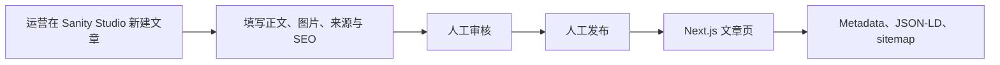
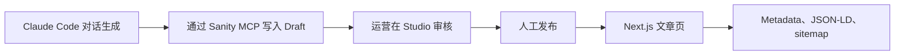

# 文章博客发布架构：人工发布 → AI自动化生产

> 状态：Draft
>
> 策略：分两阶段实施
> - **阶段一（当前优先）**：打通人工创建、审核、发布文章的完整闭环
> - **阶段二（后续规划）**：基于 Claude Code + Sanity MCP 实现 AI 批量生成、人工审核发布

---

## 阶段一：人工文章发布闭环（当前优先）

### 1.1 范围定义



**当前不做**：模型调用、批量任务、自动审核、自动发布、MCP、队列、Worker、故障切换或超时重试机制。

### 1.2 要实现的功能

#### 1.2.1 Sanity 文章模型

在现有 `ContentEntry` 基础上补齐可运营文章的最小字段：

| 字段 | 作用 | 是否必填 |
|---|---|---|
| language | `en` 或 `zh-cn`，每篇文章只对应一个语言与 URL | 是 |
| title / slug | 文章标题与唯一 URL | 是 |
| summary / body | 摘要与正文 | 是 |
| contentType | guide / tutorial / glossary / comparison 等 | 是 |
| coverImage / altText | 封面和无障碍图片描述 | 建议 |
| seo.title / seo.description | 可运营的搜索标题和描述 | 是 |
| seo.ogImage | 社交分享图 | 建议 |
| seo.noindex | 不应收录时明确排除 | 是，默认 false |
| author / reviewer | 内容与审核责任 | 是 |
| sourceCitations | 事实来源和参考链接 | 视内容而定 |
| workflowState | draft / in_review / approved | 是 |
| publishedAt | 实际发布时间 | 发布时 |

`Sanity draft/published` 只表示文档是否公开；`workflowState` 表示内部审核状态。运营人员不得以"已写完"为理由跳过审核。

#### 1.2.2 运营可配置的下拉选项与模板

不要把所有选项硬编码到文章 schema，也不要让运营每篇重新填写一遍。第一阶段新增 `EditorialProfile`（编辑配置档）文档类型，由运营维护、文章选择引用。

| 配置项 | 配置档字段 | 文章侧表现 |
|---|---|---|
| 文章类型 | `contentType`：guide / tutorial / glossary / comparison 等 | 下拉选择配置档后自动带出 |
| 字数范围 | `minWords` / `maxWords` | 显示为写作建议，不阻止人工保存 |
| 大纲 | `outlineTemplate` | 在正文编辑前提供可调整的章节模板 |
| 目标读者 | `audienceOptions` | 可选下拉值 |
| 搜索意图 | `intentOptions` | 可选下拉值 |
| CTA | `ctaOptions` | 可选下拉值 |
| 可用语言 | `allowedLocales` | 限定本配置档适用的 locale |
| 双语模式 | `languageMode`：single / paired | 选择 paired 时创建两个关联草稿 |

配置档应有 `name`、`enabled`、`sortOrder` 和 `updatedAt`，使运营能新增、停用和排序选项，而无需改代码。语言、`noindex` 和 `workflowState` 仍保留为受控字段：前两者直接影响收录，后者直接影响审核，不应变成任意自由文本。

"同时生产两个语言版本"在人工阶段的含义是：运营选择 `paired` 后，在 Studio 中创建一篇 `en` draft 与一篇 `zh-cn` draft，并使用 Sanity 官方 `@sanity/document-internationalization` 插件将两篇文章关联到 `translation.metadata` 文档。两篇文章各自有 title、slug、正文、SEO 字段、审核与发布状态；不能把中文直接当成英文的机械翻译，也不能只发布其中一篇却让另一篇出现在 `hreflang` 中。

#### 1.2.3 Studio 人工操作入口

Studio 需提供清晰的 `Content Entry` 列表和"新建文章"入口。运营人员创建文章时：

1. 选择 `EditorialProfile`、单语言或双语模式；
2. 在双语模式下分别补齐 en 和 zh-cn 的内容；
3. 填写标题、slug、摘要、正文、来源和图片；
4. 填写 SEO title、description、noindex；
5. 指定审核人，将状态从 draft 改为 in_review；
6. 审核通过后标记 approved，由人工执行 Publish。

第一版不需要复杂的自定义看板、自动动作或 Content Release。若 Sanity 套餐允许，未来可把人工发布替换为 Scheduled Draft 或 Content Release，但不得改变人工审核和人工发布确认。

#### 1.2.4 Next.js 文章前台

需要新增以下真实路由，并从 Sanity 读取**已发布**文章：

| 路由 | 功能 |
|---|---|
| `/[locale]/article` | 文章列表，按 locale 展示 |
| `/[locale]/article/[slug]` | 文章详情、正文、来源和相关文章 |

文章详情页必须实现：唯一 title/description、canonical、hreflang、Open Graph、Article JSON-LD、Breadcrumb JSON-LD、正文内有意义的站内链接；只有 `noindex !== true` 的已发布文章进入 sitemap。没有真实 FAQ 时不输出 FAQPage JSON-LD。

#### 1.2.5 发布后的前台更新

第一版允许使用 Next.js 的短缓存或手动重新部署验证发布效果。后续再接 Sanity webhook 做增量刷新；webhook 不是人工发布闭环的前置条件。

### 1.3 运营输入原则

运营只填写需要业务判断的内容，不要求反复配置技术项。

| 运营人员必填 | 使用默认值或下拉项 |
|---|---|
| 语言模式、配置档、标题、正文、目标读者、审核人 | 文章类型、标准大纲、语气、CTA 文案建议、图片尺寸、字数范围 |
| SEO title、description、是否 noindex | JSON-LD 类型、canonical 规则、hreflang |
| 来源链接或"不包含外部事实"的确认 | 字数建议、复审周期 |

字数按内容类型提供建议范围，不作为凑字 KPI。例如 glossary 通常为 500–900 字，tutorial 为 1,000–1,800 字，guide 为 1,500–2,500 字；审核重点是是否完整回答问题、是否有依据、是否重复和是否符合搜索意图。

### 1.4 当前缺口

| 缺口 | 对人工发布闭环的影响 | 需要补的功能 |
|---|---|---|
| `ContentEntry` 缺 language、`seo` 与翻译关联 | 无法为双语文章配置可运营元数据 | 扩展 schema、校验与国际化插件 |
| 没有运营可维护的配置档 | 字数、大纲、语言模式等只能靠重复输入或改代码 | 新增 `EditorialProfile` 配置文档 |
| Studio 只有默认文档列表 | 运营入口和审核状态不清楚 | 配置文章创建与审核视图 |
| 没有文章前台路由 | 发布内容无法成为可收录页面 | 实现列表页与详情页 |
| 前端 Sanity 读取仅服务首页 | 文章不会渲染 | 新增文章 GROQ 查询与类型 |
| 没有 sitemap / robots 正常实现 | 爬虫发现路径不完整 | 修复并纳入已发布可索引文章 |
| 没有文章 metadata / JSON-LD | 搜索引擎难以稳定理解页面 | 在详情页按数据生成 |
| 无人工验收清单 | 容易发布缺 SEO 或来源的文章 | 发布前检查字段与页面输出 |

### 1.5 阶段一验收标准

以下全部通过，才算人工发布链路打通：

- [ ] 运营能在 Studio 维护 `EditorialProfile`，包括文章类型、字数范围、语言模式与下拉选项。
- [ ] 运营能在 Studio 新建单语言文章，或按双语模式创建相互关联的 en / zh-cn 两篇草稿。
- [ ] 编辑页面能填写并保存正文、图片 alt、SEO title、description、noindex、来源、审核人和 workflowState。
- [ ] 人工审核后可手动发布；未发布文章不出现在前台。
- [ ] 已发布文章能通过 `/[locale]/article/[slug]` 正常访问，语言与 URL 一致。
- [ ] 页面输出正确的 title、description、canonical、hreflang、Open Graph、Article JSON-LD 和 Breadcrumb JSON-LD。
- [ ] `noindex` 文章不进入 sitemap；可索引已发布文章进入 sitemap。
- [ ] 发布一篇测试文章后，运营可在前台核对正文、图片、来源和元数据。

### 1.6 Sanity 可落地性与实施步骤

结论：**可以落地，且第一阶段只需 Sanity Studio schema、官方国际化插件和 Next.js 前台，不需要另建后台服务。**

| 草案能力 | Sanity 现有能力 | 第一阶段做法 |
|---|---|---|
| 运营可维护的下拉字典 | document + reference 输入 | 新建 `editorialProfile` 与 `editorialOption` 文档；文章使用 reference 选择 |
| 字数范围、大纲、语言模式 | 普通 document 字段、initial value template、validation | 配置档保存默认值；字数作为 Studio warning，不作为硬性发布阻断 |
| 草稿、审核、人工发布 | Draft / Published 文档与自定义字段 | 用 `workflowState` 表示 draft / in_review / approved，人工点击 Publish |
| 英中两篇关联文章 | `@sanity/document-internationalization` 官方插件 | 每篇保留独立 `language`；插件维护 `translation.metadata` 关联 |
| 一键新建不同默认文章 | Initial Value Templates | 提供"新建英文文章""新建中文文章"等模板 |
| 更清晰的运营入口 | Structure Tool | 先按文章、配置档、选项字典分组；不必先做复杂看板 |
| 双语创建快捷操作 | 国际化插件 UI；必要时 Document Actions | 先使用插件的语言选择器；只有运营确认需要"一键创建一对空草稿"时才新增小型自定义 Action |

#### 1.6.1 实施顺序

1. **扩展 schema。** 新建 `editorialProfile`、`editorialOption`，并为 `ContentEntry` 增加 `language`、`editorialProfile`、`seo`、cover image/alt、reviewer 与 workflow 字段；将配置档和选项作为强 reference，避免引用已删除的运营配置。
2. **配置国际化。** 安装 `@sanity/document-internationalization`，在 `sanity.config.ts` 中注册 `en`、`zh-cn` 和 `contentEntry` 类型；使用插件默认的 `language` 字段和 `translation.metadata` 关联，不自建 `translationGroupId`。
3. **配置 Studio 表单。** 用 fieldset、条件显示与 validation 让正文、SEO、审核字段易于填写；`noindex` 默认 false，缺 title、slug、language、SEO title、SEO description 或审核人时阻止 Studio 发布。字数只给 warning。
4. **配置运营入口。** 使用 Initial Value Templates 提供语言和工作流默认值；Structure Tool 中至少分出"文章""编辑配置档""下拉选项"。运营先建好并发布配置档/选项，再引用到文章。
5. **先手工走双语。** 新建英文文章，在国际化插件中创建中文版本；分别编写、审核、发布。先不实现"一键双语创建"，以验证真实编辑流程与语言关联。
6. **实现 Next.js 展示。** 增加文章列表和详情路由、GROQ 已发布文章查询、Portable Text 渲染、metadata、JSON-LD、`sitemap.ts` 与 `robots.ts`；只把已发布且 `noindex` 为 false 的文档加入 sitemap。
7. **用两篇真实测试文验收。** 发布一组英中关联文章和一篇 `noindex` 文章，验证 URL、前台内容、metadata、hreflang、translation 关联与 sitemap 结果；通过后再开放给运营。

#### 1.6.2 实施时的两个边界

- Sanity schema validation 只在 Studio 端执行，因此它足够服务当前"人工 Studio 发布"目标；未来若让脚本或 AI 直接写入 Sanity，才需要在服务端额外校验。
- `workflowState` 是流程提示，不是权限系统。第一阶段以人工流程为准；若以后出现不同审核角色，再用 Sanity 角色、字段只读规则或自定义 Document Action 增加限制。

---

## 阶段二：AI 自动化生产工作流（后续规划）

### 2.1 前置条件

阶段二只有在阶段一全部验收通过后才启动：

- ✅ 人工发布闭环稳定运行
- ✅ 运营熟悉 Studio 操作流程
- ✅ 文章前台展示和 SEO 验证正确
- ✅ 多语言内容管理流程顺畅

### 2.2 AI 自动化工作流设计



**核心能力：**
- Claude Code 作为内容生成工具
- Sanity MCP Server 作为写入接口
- **保留人工审核和人工发布**（不跳过）

### 2.3 关键技术组件

| 组件 | 作用 | 实现方式 |
|---|---|---|
| Claude Code | 内容生成对话界面 | 使用 Claude Code CLI 或 API |
| Sanity MCP Server | 让 Claude 直接操作 Sanity | `@modelcontextprotocol/server-sanity` 或自建 |
| 内容模板 | 规范 AI 生成格式 | 在 Claude Code 中维护提示词模板 |
| 批量任务 | 一次生成多篇文章 | Claude Code 对话 + 循环调用 MCP |
| 审核界面 | 仍使用 Studio | 复用阶段一的审核流程 |

### 2.4 工作流程

#### 2.4.1 单篇文章生成

```
运营：在 Claude Code 中描述需求
Claude：生成文章内容（标题、正文、SEO 字段）
运营：确认内容
Claude：调用 Sanity MCP 写入 draft
运营：在 Studio 中审核并发布
```

#### 2.4.2 批量文章生成

```
运营：提供关键词列表或主题大纲
Claude：逐个生成文章并写入 Sanity draft
运营：在 Studio 中批量审核
运营：逐个发布或批量发布
```

### 2.5 需要的技术准备

#### 2.5.1 Sanity MCP Server 配置

```json
{
  "mcpServers": {
    "sanity": {
      "command": "node",
      "args": ["path/to/sanity-mcp-server"],
      "env": {
        "SANITY_PROJECT_ID": "your-project-id",
        "SANITY_DATASET": "production",
        "SANITY_API_TOKEN": "your-api-token"
      }
    }
  }
}
```

#### 2.5.2 内容生成提示词模板

```
生成一篇关于 [主题] 的 [文章类型]：
- 目标读者：[读者类型]
- 字数范围：[字数]
- SEO 关键词：[关键词]
- 语言：[en/zh-cn]

输出格式：
{
  "title": "文章标题",
  "slug": "url-slug",
  "summary": "摘要",
  "body": "Portable Text 格式正文",
  "seo": {
    "title": "SEO 标题",
    "description": "SEO 描述"
  }
}
```

### 2.6 质量控制

**不跳过人工审核的原因：**
1. AI 可能生成事实错误
2. SEO 字段需要人工优化
3. 来源和引用需要人工验证
4. 品牌语气需要人工调整
5. 多语言一致性需要人工检查

**审核清单：**
- [ ] 标题和 slug 符合规范
- [ ] 正文事实准确、有依据
- [ ] SEO 字段完整且优化
- [ ] 图片和 alt 文本正确
- [ ] 来源链接有效
- [ ] 语言和语气符合品牌
- [ ] 多语言版本一致性（如有）

### 2.7 与阶段一的区别

| 维度 | 阶段一（人工） | 阶段二（AI 自动化） |
|---|---|---|
| 内容来源 | 运营手工编写 | Claude Code 生成 |
| 写入方式 | Studio 界面填写 | Sanity MCP 自动写入 |
| 审核方式 | 人工审核 | 人工审核（不变） |
| 发布方式 | 人工发布 | 人工发布（不变） |
| 批量能力 | 无 | 支持批量生成草稿 |
| 工作效率 | 低 | 高 |

### 2.8 阶段二验收标准

- [ ] Claude Code 能成功调用 Sanity MCP
- [ ] 生成的文章能正确写入 Sanity draft
- [ ] 运营能在 Studio 看到并编辑 AI 生成的草稿
- [ ] 批量生成时能稳定运行不超时
- [ ] 生成的文章字段完整（标题、正文、SEO）
- [ ] 多语言文章关联正确
- [ ] 运营审核和发布流程与阶段一一致

---

## 总结

### 核心原则

1. **先人工，后自动化**：只有人工流程稳定后才引入 AI
2. **不跳过审核**：AI 生成的内容必须人工审核和发布
3. **复用基础设施**：阶段二复用阶段一的所有 CMS 和前台能力
4. **渐进式增强**：AI 是提效工具，不是替代人工判断

### 时间规划

- **阶段一**：2-3 周，完成所有验收标准
- **阶段二**：1-2 周，在阶段一基础上增加 AI 生成能力

### 成功标志

- 阶段一：运营能独立完成文章创建→审核→发布全流程
- 阶段二：AI 能批量生成高质量草稿，人工审核通过率 > 80%
